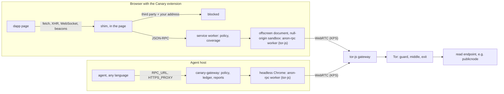

<p align="center">
  
</p>

<h1 align="center">Canary</h1>

<p align="center">
  <b>Privacy made visible, for wallets and agents.</b><br>
  See what a dapp leaks before you connect, and stop it once you do. No dapp fork required.
</p>

<p align="center">
  <a href="https://uixcanary.vercel.app"><b>Website</b></a> ·
  <a href="https://github.com/SCARPxVeNOM/canary_repo"><b>Official product repo</b></a> ·
  <a href="https://canary-leakydash.vercel.app"><b>Live demo dapp (LeakyDash)</b></a>
</p>

<p align="center">
  Built at <b>ETHGlobal Mumbai 2026</b> · on the Ethereum Foundation's <a href="https://github.com/ethereum/anon-rpc">anon-rpc</a>
</p>

---

> [!NOTE]
> **This repository is the Canary landing website.** The product itself (browser extension, agent gateway, SDK, scanner and ENSv2 tooling) lives in the official repo, **[SCARPxVeNOM/canary_repo](https://github.com/SCARPxVeNOM/canary_repo)**. Everything about the product below is taken from that repo as of commit [`250983f`](https://github.com/SCARPxVeNOM/canary_repo/commit/250983f) (6 Nov 2026). For the source, tests and the latest status, go there.

## Contents

- [The problem](#the-problem)
- [What Canary does](#what-canary-does)
- [How it works](#how-it-works)
- [What Canary reports](#what-canary-reports)
- [Evidence: real dapps, before and after](#evidence-real-dapps-before-and-after)
- [Canary for agents](#canary-for-agents)
- [ENSv2: declared vs observed](#ensv2-declared-vs-observed)
- [Get Canary](#get-canary)
- [Privacy and security model (CROPS)](#privacy-and-security-model-crops)
- [Project status](#project-status)
- [Known limits](#known-limits)
- [About this website](#about-this-website)
- [Credits and license](#credits-and-license)

## The problem

Dapps built on wagmi/viem send your reads (`balanceOf(you)`, allowances, positions) straight from your browser to **their** RPC provider, and often send your address to analytics too. Your wallet's RPC settings never touch that traffic.

So one balance check can hand a stranger three things at once:

- **your wallet address**, in the call's parameters (for example `eth_getBalance`);
- **your IP address**, in the connection;
- **which app you're using**, in the provider URL or project key.

Agents have the same problem, and worse: their reads reveal their *strategy* before they act (quotes, allowances, positions), one server IP links a whole fleet of agent wallets, and LLM providers see wallet addresses in every prompt.

## What Canary does

Canary is a Chrome (MV3) browser extension that works on any dapp, unmodified:

| | What it does | What the third party sees |
|---|---|---|
| 🛡️ **Enforce** | Answers the dapp's own RPC reads through **anon-rpc over Tor**, so the dapp's provider never receives them. | A Tor exit relay, not you |
| ⛔ **Block** | Blocks third-party requests that carry your wallet address: `fetch`, XHR, WebSocket, beacons and tracking pixels. | Nothing; the request never leaves |
| 📊 **Measure** | Reports **measured coverage**: what was protected, blocked, left exposed, or not inspected. Gaps are shown, never hidden. | — |

The dapp itself can always see your address and your IP. Canary protects you from **third parties**: RPC providers, analytics and trackers.

The same core also protects **autonomous agents**, through a local gateway, a TypeScript SDK and an ENSv2 name per agent. See [Canary for agents](#canary-for-agents).

## How it works



*Diagram adapted from the official README.*

### Inside the extension

1. **The shim** runs in the page at `document_start`, in every frame, and wraps `fetch`, XHR, WebSocket and `sendBeacon` before any page script runs.
2. **JSON-RPC traffic** goes to the service worker:
   - a **standard read** on a supported chain is answered from Canary's own read endpoint for that chain, via anon-rpc → **Protected**;
   - a **non-standard method** is forwarded to the dapp's original URL over the same anon path. Your IP is hidden, but the URL still identifies the app → **Protected (IP only)**;
   - if the **anon path is down**, the dapp gets a JSON-RPC error → **Failed closed** (unless you opt that site into direct fallback).
3. **Address leaks:** a request to a third party that contains your address is blocked. `declarativeNetRequest` rules also catch pixels and other URL-only requests.
4. **The anon-rpc worker** (tor-js, hash-pinned on chain) runs in a null-origin sandbox with none of the extension's permissions. It builds Tor circuits in the browser and reaches relays through a tor-js gateway over WebRTC.

### Address matching

Canary learns your address from the wallet (EIP-1193 `eth_accounts` / `eth_requestAccounts`, EIP-6963 announcements, `accountsChanged`), or you add it in the popup.

Matching is **exact, never heuristic**: the 40 hex digits case-insensitively (checksummed, lowercase, no `0x`, ABI-padded, URL-encoded), plus base64 of the raw bytes and of the hex string. Hashed or encrypted addresses can slip past, and bodies Canary can't read are labelled **Not inspected**.

### One circuit per wallet

Each request carrying one of your addresses gets its own isolation key, `addr:<address>`. tor-js puts each key on its own circuit and TLS session, so the exit relay can't link two of your wallets.

### Making Tor fast enough for dapps

Each request over tor-js costs about 1 s whatever its size, so Canary sends fewer of them:

- **Batch:** calls for the same endpoint and key arriving within **15 ms** leave as one JSON-RPC batch (max 20), never mixing addresses.
- **Cache:** `eth_chainId` / `net_version` and deployed `eth_getCode` are cached for good; `eth_blockNumber` for 2 s.
- **Dedupe:** identical in-flight calls share one answer.
- **Pre-warm:** when the wallet reveals an address, Canary builds that address's circuit before the dapp's first read (~1.15 s warm vs ~2.0 s cold).
- **Hedge:** a read that fails, or hasn't answered within **3 s**, is resent on a fresh circuit and the first answer wins.
- **Writes are untouched:** `eth_sendRawTransaction` and signing are forwarded byte for byte, once.

## What Canary reports

Coverage categories, from [`@canary/core`](https://github.com/SCARPxVeNOM/canary_repo/blob/main/packages/core/src/coverage.ts). The wording rule in the code is: *never "private" or "leak-free"; always "observed, with gaps".*

| Category | Meaning |
|---|---|
| **Protected** | Answered via anon-rpc from Canary's read endpoint |
| **Protected (IP only)** | Forwarded via anon-rpc to the original URL: IP hidden, app still identifiable |
| **Blocked** | Refused by policy |
| **Detected, unprotected** | Carries an address and left as-is (for example, to the dapp's own backend) |
| **Backend / indexer** | Non-RPC API traffic, listed by destination |
| **Not inspected** | A body or channel Canary could not read. Never counted as protected |
| **Failed closed** | Anon path down: answered with an error instead of going direct |
| **Direct** | Sent normally, because you or the policy allowed it |
| **Local node** | An RPC on your machine or private network: no third party |
| **Pseudonymized** *(agents)* | Addresses replaced before reaching an LLM or tool |
| **Undeclared** *(agents)* | Egress to a host not in the agent's manifest |

A zero-leak result applies only to the channels Canary inspected and the flows that were exercised. *"No leak observed" is not "no leak".*

## Evidence: real dapps, before and after

Recorded with Canary's [scanner](https://github.com/SCARPxVeNOM/canary_repo/tree/main/scanner) on **6 Nov 2026**: Playwright + mitmproxy + a fake wallet holding a fresh **synthetic** address for each run; flows were load → connect → scroll. Raw output: [`test-artifacts/scans/RESULTS.md`](https://github.com/SCARPxVeNOM/canary_repo/blob/main/test-artifacts/scans/RESULTS.md).

| Dapp | Third parties that got the address | RPC calls leaving the page directly | RPC coverage via anon-rpc | Blocked |
|---|---|---|---|---|
| app.aave.com | 3 → **0** | 13 → 11 | 0% → **15%** | 9 |
| app.ens.domains | 2 → **0** | 3 → **0** | 0% → **100%** | 2 |
| app.uniswap.org | 0 → **0** | 4 → **0** | 0% → **100%** | 0 |
| revoke.cash | 3 → **0** | 3 → **0** | 0% → **100%** | 0 |
| snapshot.box | 4 → **0** | 2 → **0** | 0% → **100%** | 6 |

**Across five dapps, third-party address leaks went from 12 to 0.** Aave stays at 15% because it uses its own first-party RPC proxy, which Canary doesn't recognize yet.

Who was receiving the address before Canary, for example: `browser-intake-datadoghq.com` and `mainnet.gateway.tenderly.co` (Aave), `lb.drpc.live` and `api.bigname.sh` (ENS), `eth-mainnet.g.alchemy.com` (revoke.cash), `stamp.fyi` and `rpc.brovider.xyz` (Snapshot).

On the live **LeakyDash** demo over tor-js: third parties receiving the address **2 → 0**, coverage **0% → 100%**.

> These are recorded scans, not live data, and not a safety score.

## Canary for agents

The same core, packaged for autonomous agents. Design and rationale: [`agent-sdk.md`](https://github.com/SCARPxVeNOM/canary_repo/blob/main/agent-sdk.md).

### 1. The gateway: any language, zero code changes

A local process (`canary-gateway`) that any agent points its RPC URL and HTTP proxy at:

```sh
RPC_URL=http://127.0.0.1:18545/<chainId>   # chain reads go through anon-rpc
HTTPS_PROXY=http://127.0.0.1:18080         # per-host rules: anon, direct or block
```

It runs anon-rpc in a headless Chrome it manages, splits batches per wallet, refuses node-side signing, fails closed, adds timing jitter, and keeps a ledger for signed reports. An opt-in local CA (`canary-gateway ca`) lets it route chosen HTTPS hosts through anon-rpc too. The [Python example](https://github.com/SCARPxVeNOM/canary_repo/tree/main/examples/python-agent) uses only those two environment variables.

### 2. The SDK: `@canary/agent` for TypeScript

```ts
import { createCanary } from "@canary/agent";

const canary = await createCanary({ gateway: "http://127.0.0.1:18545", wallets: [account.address] });

const client = createPublicClient({ chain: sepolia, transport: canary.viemTransport() }); // viem
const provider = await canary.ethersProvider(11155111);                                  // ethers v6
const openai = new OpenAI({ fetch: canary.llmFetch }); // wallet addresses → WALLET_1 before the prompt leaves
const tools = canary.wrapTools(myTools);               // real addresses restored before tools run

canary.on("egress", (e) => console.log(e));            // every decision, live
const { signed, coarse } = await canary.report();      // coverage + signed report
```

`llmFetch` replaces the agent's wallets with `WALLET_1`, `WALLET_2`…, other addresses with `ADDR_1`…, 32-byte hashes with `HASH_1`… and the agent's ENS name with `AGENT_NAME`. Allow-listed contracts stay as they are. Amounts and balances are deliberately left unchanged (and declared as such). Aliases are restored in responses and in tool arguments, and an alias Canary never issued fails the tool call.

### 3. The policy: an ENSv2 name per agent

Each agent gets a subname (for example `trader-01.agents.canary.eth`) whose `privacy.manifest` record **is** the policy the gateway enforces: *declared = enforced*. Undeclared hosts are blocked by default.

```json
{
  "v": 1,
  "agent": "trader-01.agents.canary.eth",
  "hosts": { "api.openai.com": "direct", "*.coingecko.com": "anon", "tracker.example": "block" },
  "undeclared": "block",
  "rpc": { "write": "anon" },
  "wallets": "undisclosed"
}
```

The gateway publishes a signed, deliberately coarse `privacy.report` back to the name, using a key that can write that one record and nothing else. Revoking that key's role is visible to anyone reading the name.

## ENSv2: declared vs observed

For dapps, Canary compares what a site **declares** with what Canary **observes**:

- A site points at its ENS name via `/.well-known/canary.json`. Canary reads that name's `url` and `privacy.manifest` records **over anon-rpc**, so no RPC provider learns which dapp you're on. The binding must hold both ways.
- The popup lists every third party that received your address or RPC calls as **declared** or **not declared**.
- An independent verifier (`verifier.canary.eth`) scans the site and signs a verdict into `privacy.verdict.canary` under a one-key grant. Canary checks the EIP-712 signature, shows expired verdicts as expired, and shows *"independent verification revoked"* if the verifier's role is gone.

Live on Sepolia: `leakydash.eth`, `canary.eth`, `verifier.canary.eth`, `agents.canary.eth` and `trader-01.agents.canary.eth`.

## Get Canary

Full instructions are in the [official README](https://github.com/SCARPxVeNOM/canary_repo#quick-start). In short:

**Requirements:** Node.js and npm, Docker (for the tor-js gateway), and Chrome or Chromium.

**1. Run a tor-js gateway.** Browsers can't open the raw TCP connections Tor needs, so tor-js reaches Tor through a gateway. The EF demo gateway stopped completing boots on 6 Nov 2026, so run your own:

```sh
git clone https://github.com/SCARPxVeNOM/canary_repo.git && cd canary_repo
docker build -t canary-gateway gateway/
docker run -d --name canary-gateway --restart unless-stopped -p 12298:12298/udp \
  -e ADVERTISE=127.0.0.1 -v canary-gateway:/data canary-gateway
docker logs canary-gateway            # prints the address: 127.0.0.1:12298:<certhash>
npm run gateways -- <that address>    # writes it into every default config
```

**2. Build and load the extension.**

```sh
cd extension && npm install && npm run build   # → extension/dist
```

Open `chrome://extensions`, turn on **Developer mode**, click **Load unpacked** and pick `extension/dist`. Reload your dapp tabs. Use a separate Chrome profile, since the extension runs on every site. The first Tor boot takes about 13 s.

**3. Agents (optional).**

```sh
npm install && npm run build     # at the repo root
cd examples/viem-agent
npm run gateway                  # terminal 1
WALLET=0x… npm run agent         # terminal 2 (npm run agent:leaky for the before/after)
```

## Privacy and security model (CROPS)

Summarised from the official README.

**Who learns what:**

| Party | Learns | Doesn't learn |
|---|---|---|
| tor-js gateway | Your IP, that you use Tor, traffic volume and timing | Destinations or contents |
| Read endpoint | Which addresses are queried | Your IP, or which dapp you use |
| The dapp itself | Your address and IP (always) | — |
| Canary's team | Nothing: no analytics or telemetry | — |

- **Censorship resistance:** gateways are a list with failover, and anyone can run one from a single Docker container. If every gateway or the read endpoint goes away, Canary **fails closed** and says so.
- **Open source:** MIT. Everything builds from the repo, including the scripts behind the measurements.
- **Privacy:** batching never mixes calls about different addresses. Canary's team never runs both a gateway and a read endpoint, so no single operator can match the two by timing.
- **Security:** Canary never holds keys or signs anything. The anon-rpc worker is hash-pinned on chain and sandboxed. Read endpoints could lie about responses; proof verification is future work.

## Project status

| Part | State (6 Nov 2026) |
|---|---|
| Browser extension | Working. End-to-end test 41/41 against a leaky fixture dapp |
| Dapp scanner | Working. Results above |
| Demo dapp ([LeakyDash](https://canary-leakydash.vercel.app)) | Live |
| ENSv2 manifests and signed verdicts | Live on Sepolia |
| `@canary/core` | Done, shared by the extension and agent packages |
| Agent gateway | Working; live over tor-js: 24/24 checks |
| Agent SDK (`@canary/agent`) | Working: viem, ethers, `fetch`, LLM pseudonymizer, `wrapTools` |
| Agent ENSv2 names | Working; live on Sepolia |
| AgentKit / Eliza / LangChain adapters | Not started |

## Known limits

- The dapp always sees the address you give it, and your IP.
- `eth_subscribe` and other WebSocket methods that can't be substituted go out as-is, reported as *detected*.
- `sendBeacon` with a Blob body, service workers and WebRTC traffic from the page aren't inspected.
- Hashed, encrypted or obfuscated addresses can't be matched.
- First-party RPC proxies Canary doesn't recognize (like Aave's) stay unprotected.
- For dapps, the ENS manifest is compared, not enforced.

## About this website

This repo is a single static page, with no build step and no dependencies.

```
index.html               the landing page (HTML, CSS and JS in one file)
assets/bird.png          Canary bird logo
assets/favicon.png       browser-tab icon
assets/images/note-*.jpg illustrations for the five "How it works" notes
```

**Run it locally:**

```sh
python3 -m http.server 8765    # then open http://127.0.0.1:8765
```

Or just open `index.html` in a browser.

**Deploy:** the site is on Vercel as the `uixcanary` project, and every push to `main` redeploys it to **https://uixcanary.vercel.app**. To deploy by hand: `vercel deploy --prod`.

**Editing:**
- **Chrome Web Store link:** set `EXTENSION_URL` near the bottom of `index.html`, and every "Get extension" button will point to it.
- **Evidence table:** the rows are defined in the `rows` array in the same script.
- **Sponsor logos:** the six sponsor boxes are still placeholders.

## Credits and license

- **Canary** is built by the Canary team at ETHGlobal Mumbai 2026. Official repo: **[github.com/SCARPxVeNOM/canary_repo](https://github.com/SCARPxVeNOM/canary_repo)**, released under the MIT license.
- Built on the Ethereum Foundation's [anon-rpc](https://github.com/ethereum/anon-rpc) and tor-js.
- Product facts, figures, code samples and the architecture diagram in this README come from the official repo.
